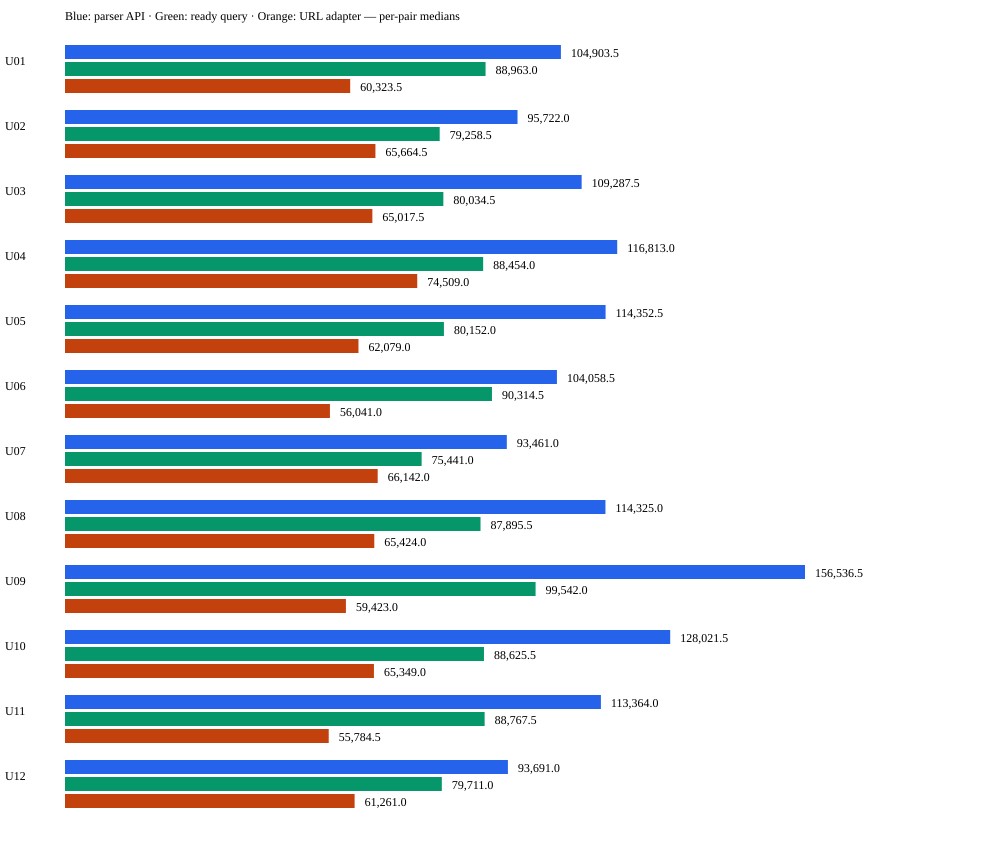

# Historical evidence carried into the spin-off

The copied metric files describe the Python research workflow in Spotlightning. They are not results for this Go scaffold.

| Investigation | Finding | What it supports |
|---|---|---|
| Larger generated report collections | 30.6–39.7% lower median tokens than agent-written aggregation, but no advantage over a ready-made query | Packaging comparisons can save setup effort under some tasks |
| Large real CI and failure-heavy runs | The 30% goal did not hold; more data or failures did not consistently help | Dataset size alone is not the value proposition |
| Corrected cross-run comparison | 35.06% fewer primary-cohort median tokens vs parser assembly; 0.80% fewer vs ready-made diff | Benefits shrink against a capable existing comparison |
| Recurring failures | 19.66% fewer vs parser assembly; 0.25% more vs ready query | No demonstrated advantage over the ready query in that small case study |
| Starting from run URLs | 42.63% fewer vs parser assembly; 24.36% fewer vs ready query | First-use discovery/setup convenience on captured Prow/GCS inputs |

The latest study used 12 previously unused consecutive pairs across eight projects, 24 runs, 220 distinct reports and 72 investigations. All 72 required-fact, inventory and acquisition-trace checks passed. Human narrative review remains pending. Each investigation started in a fresh workspace; this does not establish an advantage over an already-written reusable URL script. Recorded provider responses were replayed, so it does not measure live network reliability or latency.

[Compact metrics](url-first/summary.json) · [audit result](url-first/audit-result.json) · [tamper/relocation checks](url-first/verification.json)

The audit result is a historical attestation, not a rerunnable audit with this small starter alone. Original inputs, 11-chart HTML report, agent outputs and audit code remain in the original project under `docs/evaluation/results/2026-11-06-url-first-v1`. [The external archive catalog](external-archive-catalog.json) records exact archive hashes and sizes so those optional bundles can be obtained from the original project's custodian. They are local-only, not public downloads. Nothing in the starter tests or Go port requires them.

Earlier result identifiers in the original project: `2026-11-05-test-scale.md`, `2026-11-05-real-ci.md`, `2026-11-05-failure-density.md`, `2026-11-05-cross-run-v4.md`, `2026-11-05-recurring-v1.md`. Results from different studies are not pooled.
