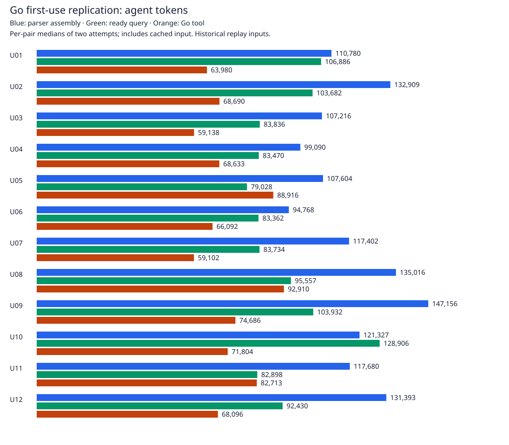

# Go first-use token study — 2026-11-06

**The Go-assigned workflow used 41.53% fewer agent tokens than parser-based assembly and 27.23% fewer than a ready-made query**, measured as median paired savings. This broadly reproduces the historical first-use benefit; it does not establish repeated-use savings.

**Important exception:** 23/24 Go-assigned attempts ran the Go comparison. In U08 repetition 1, the agent ran `testreceipts --help` successfully, then chose the permitted Python helpers instead. All of that attempt's costs remain in the results. These are workflow measurements including one fallback, not a 24/24 Go-only execution study. No replacement trials were run.

All **72/72 required-fact and inventory checks passed** across 12 historical run pairs from eight projects, with three approaches and two repetitions. The 24 Go-assigned attempts all returned correct required facts, including incomplete/no-evidence states. Independently, the Go executable matched the complete frozen Python output on [12/12 historical pairs](../go-token-preflight/README.md). Passing these checks does not mean the underlying CI suites passed or that human narrative review is complete.

| Baseline | Historical Python study | Current Go-assigned workflow | Per-pair range | Exploratory 95% interval |
|---|---:|---:|---:|---:|
| Agent assembly using an existing parser | 42.63% fewer | **41.53% fewer** | 17.37–49.66% fewer | 30.50–48.25% fewer |
| Existing ready-made comparison query | 24.36% fewer | **27.23% fewer** | 12.51% more to 44.30% fewer | 10.27–31.60% fewer |

The ready-query comparison still missed the historical exploratory 30% target. One pair used over 10% more tokens than the ready query. The intervals use 10,000 paired-case bootstrap resamples with a fixed seed; with only 12 pairs they are exploratory, not proof that the historical and new percentages are equivalent. Aggregate savings were 39.20% and 23.32%, respectively; these are distinct from the median paired headline figures.



## What was measured

The same model setting (`gpt-6-astra`, low reasoning), historical captured Prow/GCS inputs, questions, answer schema, balanced schedule and capable baselines were reused. All 72 investigations were rerun, rather than comparing fresh Go runs to old baseline totals. Each began in a fresh workspace with the same generic discovery/parser helpers. Tools and recordings were already supplied; build/install costs were not measured. The integrated Python URL helper was replaced by the current Go executable; its actual `compare-recording` command takes a recording path plus two URLs. The protocol allowed lower-level helper use in every approach, so the fallback is retained.

The executable was built from clean Go source revision `48a50877c78b7e1d7fadfdac87104fd7fe6fc523`, using Go 1.27.3 on macOS arm64. This was a development build, not a release size/speed benchmark. The installed Codex CLI was `0.167.0-alpha.3.2`, versus `0.166.0-alpha.6` historically. The changed CLI/workspace environment means differences from the historical study cannot be attributed solely to the implementation language.

For each pair, take the median total tokens of its two assigned-Go attempts and of its two baseline attempts. Compute `100 × (1 − Go / baseline)`, then take the median of those 12 percentages. Total tokens are reported input plus output, **including cached input**, tool interaction, extra steps and failed commands. Cached and uncached input are retained separately. These percentages are not dollar-cost savings. No sampling-request retries were reported; each attempt logged the same unrelated Firebase MCP startup warning, retained in the diagnostics.

## Checks and inspectable evidence

- [Metrics and limitations](summary.json), [72 per-attempt scores and usage](attempts.json), [separate session counters](rollout-usage.json).
- [Exact URLs, questions and expected facts](inputs-expected.json), [agent explanations for review](narratives.json).
- [Raw-record reconstruction audit](audit.json), [configuration](run-config.json), [build/source provenance](execution-context.json), [protocol changes](provenance.json), [runner diagnostics](runner-diagnostics.json).
- [Raw evidence catalog](raw-catalog.json): hashes and sizes of original inputs, frozen protocol, runner and all attempt records/traces. Full recordings, working outputs and traces remain local in ignored `.artifacts/go-url-first-v1`; they are not uploaded or shipped with the CLI. The optional original archives remain described in the [historical catalog](../external-archive-catalog.json).

All 72 usage records agree with separate saved Codex session counters. The audit reconstructed answers, required-field scores, inventory scores and usage from raw traces; checked source immutability, 72 unique sessions and the frozen sequential schedule; and reconstructed the summary. The export independently recalculated median paired savings. Go comparison invocation was checked in command traces, including execution through a Python subprocess.

These are research checks, not an adversarial security attestation. Go SDK acquisition-event telemetry was not available, so **no 72/72 acquisition-trace coverage claim is made**. Human narrative review remains pending. Inputs were already inspected historical data, not newly held-out samples. This study does not measure live networking, modern MCP/client integration, other models, prepared reusable URL wrappers, repeated use or Go speed/size advantages.

## Reproduce the audit without model calls

With the retained local study directory:

```sh
python3 .artifacts/go-url-first-v1/runner.py audit --root .artifacts/go-url-first-v1
python3 .artifacts/go-url-first-v1/usage-counter-check.py .artifacts/go-url-first-v1
python3 tools/report_go_agent_study.py --root .artifacts/go-url-first-v1 --out evidence/go-url-first
```

The tools `go_agent_study.py prepare` and `run` preserve the execution protocol for a future explicitly authorized replication. They do not run during ordinary tests or installation. The authorized 72-trial campaign is complete; additional trials need a new instruction. The [broader repeated-use study](../../docs/STUDY-PLAN.md) remains deferred.
